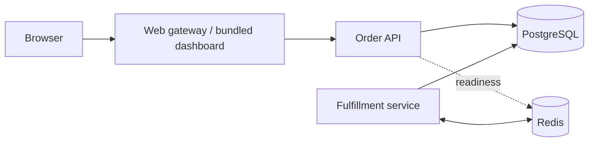

# Architecture

OrderDesk uses three independently deployed application services: the web gateway, order API, and fulfillment service. PostgreSQL and Redis provide storage and messaging.

## Order lifecycle

1. The gateway serves the dashboard and forwards `/api/` requests to the API using Docker DNS.
2. The API validates customer name, product ID, and quantity. Prices come from the catalog, never the browser. Monetary values are integer USD cents.
3. A single database transaction inserts the pending order and its outbox entry. Returning HTTP 201 means the write committed.
4. Fulfillment dispatches unfinished outbox entries into Redis. Dispatch timestamps limit repeat enqueueing to once per ten seconds per unfinished order.
5. The worker consumes queued order IDs, locks the outbox row, updates the order and completes the outbox entry in one transaction. Duplicate deliveries are harmless.
6. If a process dies after dequeueing, the unfinished outbox entry becomes eligible again. Redis is transport, not the source of truth.

The sample fulfillment operation changes the order's state; it does not call a warehouse, charge a card, or send mail. Integrations with external side effects need their own idempotency contract.

## Service boundaries

The gateway owns presentation and routing. The API owns catalog reads and accepting orders. Fulfillment owns dispatch and processing. API and worker share a Python image but use separate commands, environments, restart policies and health checks. Each can be deployed independently from the same source version.

The initial architecture deliberately uses a shared PostgreSQL schema, not database-per-service isolation. This keeps order/outbox writes atomic and local operation small, but couples schema migrations and database availability across services. Multiple worker replicas can coordinate through row locks; the shared heartbeat reports the worker fleet's recent activity, not each replica independently.

## Health and evidence

`/api/health/live` reports that the API process responds. `/api/health/ready` verifies PostgreSQL catalog access and Redis connectivity; it returns 503 when either fails. The API can still durably accept orders during a Redis interruption when reached directly through the gateway. `/api/status` includes dependency states, aggregate order counts, total order value, worker heartbeat, and last successful fulfillment.

A heartbeat older than 15 seconds is stale. Heartbeat means the worker loop is active, not that every dependency or order is healthy. Compare pending orders, last success, readiness, and logs. JSON application events include service name, timestamps, order IDs and request IDs. Credentials and customer names are not logged.

## Persistence and schema

Compose owns dedicated `postgres-data` and `redis-data` volumes. PostgreSQL bootstrap SQL runs only on the first start of an empty database. Schema changes require explicit migrations; editing bootstrap SQL does not migrate an existing volume. Neither startup nor ordinary shutdown deletes stored orders.
